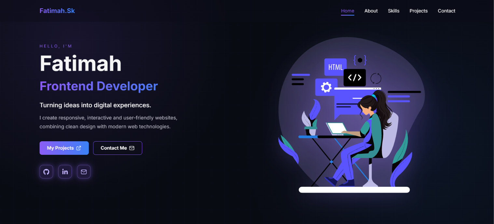

# 💜 Fatimah's Portfolio



## 👩‍💻 About This Project
Welcome to my personal portfolio website!

I'm **Fatimah**, an IT graduate and Frontend Developer with 10 years of experience teaching Information Technology. I'm passionate about creating modern, responsive, and user-friendly web applications.

This portfolio showcases my technical skills, development projects, and experience as I continue growing in web development.

## 🌐 Live Demo

**[View My Portfolio](https://fatimah-sk.github.io/Portfolio/)**

## ✨ Features

- **Responsive Design** – Optimized for desktop, tablet, and mobile devices.
- **Animated Welcome Screen** – Interactive intro with a typewriter effect.
- **Smooth Animations** – Entrance animations and interactive hover effects.
- **About Me** – Information about my background and experience.
- **Technical Skills** – Overview of the technologies I work with.
- **Projects Gallery** – A collection of development projects with interactive previews.
- **Contact Section** – Links to GitHub, LinkedIn, and email.
- **Modern UI** – Dark theme with purple and blue gradients.

## 🛠️ Technologies Used

- **React** – Component-based user interface
- **JavaScript (ES6+)** – Application logic and interactivity
- **HTML5** – Semantic structure
- **CSS3** – Responsive layouts, animations, and styling
- **Vite** – Development and build tool
- **React Icons** – Icons and visual elements
- **Lottie** – Animated illustrations
- **Git & GitHub** – Version control
- **GitHub Pages** – Website hosting and deployment

## 📂 Portfolio Sections

| Section | Description |
|---|---|
| Home | Introduction and quick navigation |
| About | My professional background and experience |
| Skills | Technologies and development tools |
| Projects | Selected projects with previews and links |
| Contact | Ways to get in touch |

## 💻 Getting Started

To run this project locally:

**1. Clone the repository**

```bash
git clone https://github.com/Fatimah-sk/Portfolio.git
```

**2. Navigate to the project directory**

```bash
cd Portfolio
```

**3. Install dependencies**

```bash
npm install
```

**4. Start the development server**

```bash
npm run dev
```

Open the local URL displayed in your terminal to view the website.

## 🚀 Deployment

This portfolio is deployed using **GitHub Pages**.

**Live website:** https://fatimah-sk.github.io/Portfolio/

## 📬 Contact

I'm open to professional opportunities, collaboration, and connecting with others in the technology field.

You can find my contact information and social media links on my portfolio website.

**[Get in Touch](https://fatimah-sk.github.io/Portfolio/#contact)**

---

Made with 💜 using **React & Vite**.

© 2026 Fatimah.Sk
